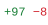
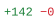

### Abstract

I'm **Phu**. I work on computer vision and build the systems around it.

### Featured

<!-- feat:start -->
**[INT8 quantization for RF-DETR on TensorRT](https://github.com/roboflow/rf-detr/pull/1595)**&nbsp;&nbsp;[`roboflow/rf-detr`](https://github.com/roboflow/rf-detr) `export(format="tensorrt", quantization="int8")` for detection, segmentation and keypoint models. I place the **Q/DQ nodes myself** on the FP16 graph, run the patch embedding as a **matrix multiply**, and fold **SmoothQuant scales** and **bias correction** into the backbone. [`#1595`](https://github.com/roboflow/rf-detr/pull/1595) · [`#1627`](https://github.com/roboflow/rf-detr/pull/1627) · [`#1638`](https://github.com/roboflow/rf-detr/pull/1638) · [`#1642`](https://github.com/roboflow/rf-detr/pull/1642) · [`#1645`](https://github.com/roboflow/rf-detr/pull/1645)
<!-- feat:end -->

### Contributions

<!-- os:start -->

<a href="https://github.com/roboflow/rf-detr/pulls?q=is%3Apr+is%3Amerged+author%3Althphuw"><picture><source media="(max-width: 600px)" srcset="https://raw.githubusercontent.com/lthphuw/lthphuw/main/assets/blank.svg"></picture></a>&#8203;<a href="https://github.com/roboflow/rf-detr/pulls?q=is%3Apr+is%3Amerged+author%3Althphuw"><picture><source media="(min-width: 601px)" srcset="https://raw.githubusercontent.com/lthphuw/lthphuw/main/assets/blank.svg"></picture></a> 

<a href="https://github.com/roboflow/rf-detr/pull/1645/files"><picture><source media="(max-width: 600px)" srcset="https://raw.githubusercontent.com/lthphuw/lthphuw/main/assets/blank.svg"></picture></a><a href="https://github.com/roboflow/rf-detr/pull/1645"><code>#1645</code></a>&nbsp;&nbsp;|&nbsp; perf(export): smooth the backbone norms and correct the MLP biases of TensorRT INT8 detection engines&#8203;<a href="https://github.com/roboflow/rf-detr/pull/1645/files"><picture><source media="(min-width: 601px)" srcset="https://raw.githubusercontent.com/lthphuw/lthphuw/main/assets/blank.svg"></picture></a> 

<a href="https://github.com/roboflow/rf-detr/pull/1642/files"><picture><source media="(max-width: 600px)" srcset="https://raw.githubusercontent.com/lthphuw/lthphuw/main/assets/blank.svg"></picture></a><a href="https://github.com/roboflow/rf-detr/pull/1642"><code>#1642</code></a>&nbsp;&nbsp;|&nbsp; perf(export): run the segmentation and keypoint INT8 patch embedding as a matrix multiply&#8203;<a href="https://github.com/roboflow/rf-detr/pull/1642/files"><picture><source media="(min-width: 601px)" srcset="https://raw.githubusercontent.com/lthphuw/lthphuw/main/assets/blank.svg"></picture></a> 

<a href="https://github.com/roboflow/rf-detr/pull/1635/files"><picture><source media="(max-width: 600px)" srcset="https://raw.githubusercontent.com/lthphuw/lthphuw/main/assets/blank.svg"></picture></a><a href="https://github.com/roboflow/rf-detr/pull/1635"><code>#1635</code></a>&nbsp;&nbsp;|&nbsp; feat(models): accept one <code>threshold</code> per class in <code>predict</code>&#8203;<a href="https://github.com/roboflow/rf-detr/pull/1635/files"><picture><source media="(min-width: 601px)" srcset="https://raw.githubusercontent.com/lthphuw/lthphuw/main/assets/blank.svg"></picture></a> 

<a href="https://github.com/roboflow/rf-detr/pulls?q=is%3Apr+is%3Amerged+author%3Althphuw">+27 more →</a>

<a href="https://github.com/roboflow/trackers/pulls?q=is%3Apr+is%3Amerged+author%3Althphuw"><picture><source media="(max-width: 600px)" srcset="https://raw.githubusercontent.com/lthphuw/lthphuw/main/assets/blank.svg"></picture></a>&#8203;<a href="https://github.com/roboflow/trackers/pulls?q=is%3Apr+is%3Amerged+author%3Althphuw"><picture><source media="(min-width: 601px)" srcset="https://raw.githubusercontent.com/lthphuw/lthphuw/main/assets/blank.svg"></picture></a> 

<a href="https://github.com/roboflow/trackers/pull/614/files"><picture><source media="(max-width: 600px)" srcset="https://raw.githubusercontent.com/lthphuw/lthphuw/main/assets/blank.svg"></picture></a><a href="https://github.com/roboflow/trackers/pull/614"><code>#614</code></a>&nbsp;&nbsp;|&nbsp;   fix(ocsort): encode ORU virtual boxes with <code>bbox_to_measurement</code> for XCYCWH&#8203;<a href="https://github.com/roboflow/trackers/pull/614/files"><picture><source media="(min-width: 601px)" srcset="https://raw.githubusercontent.com/lthphuw/lthphuw/main/assets/blank.svg"></picture></a> 

<a href="https://github.com/roboflow/trackers/pull/613/files"><picture><source media="(max-width: 600px)" srcset="https://raw.githubusercontent.com/lthphuw/lthphuw/main/assets/blank.svg"></picture></a><a href="https://github.com/roboflow/trackers/pull/613"><code>#613</code></a>&nbsp;&nbsp;|&nbsp; fix(base): reject non-finite boxes before <code>update()</code> mutates  tracker state&#8203;<a href="https://github.com/roboflow/trackers/pull/613/files"><picture><source media="(min-width: 601px)" srcset="https://raw.githubusercontent.com/lthphuw/lthphuw/main/assets/blank.svg"></picture></a> 

<a href="https://github.com/sunsmarterjie/yolov12/pulls?q=is%3Apr+is%3Amerged+author%3Althphuw"><picture><source media="(max-width: 600px)" srcset="https://raw.githubusercontent.com/lthphuw/lthphuw/main/assets/blank.svg"></picture></a>&#8203;<a href="https://github.com/sunsmarterjie/yolov12/pulls?q=is%3Apr+is%3Amerged+author%3Althphuw"><picture><source media="(min-width: 601px)" srcset="https://raw.githubusercontent.com/lthphuw/lthphuw/main/assets/blank.svg"></picture></a> 

<a href="https://github.com/sunsmarterjie/yolov12/pull/174/files"><picture><source media="(max-width: 600px)" srcset="https://raw.githubusercontent.com/lthphuw/lthphuw/main/assets/blank.svg"></picture></a><a href="https://github.com/sunsmarterjie/yolov12/pull/174"><code>#174</code></a>&nbsp;&nbsp;|&nbsp; Fix DataLoader collate crash when a batch mixes background and labelled images&#8203;<a href="https://github.com/sunsmarterjie/yolov12/pull/174/files"><picture><source media="(min-width: 601px)" srcset="https://raw.githubusercontent.com/lthphuw/lthphuw/main/assets/blank.svg"></picture></a> 

<!-- os:end -->
